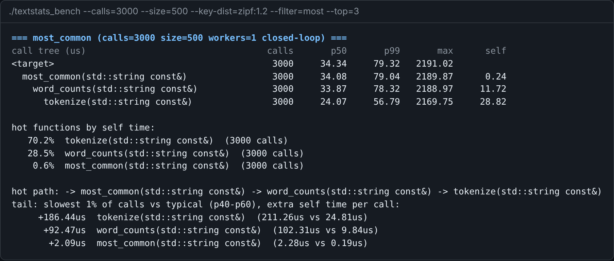
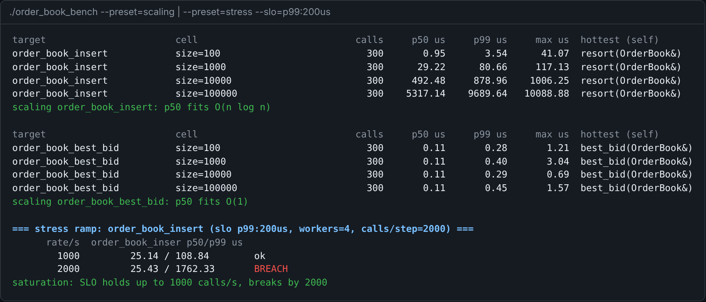

# HopTrace

**Per-hop latency profiling and load testing for any C++ codebase.**

You point HopTrace at the functions you want to test. It calls them many times, under the load you choose, and measures the latency of **every function they call on the way down** (every "hop"). Then it shows you the call tree with p50/p99/max per hop, where the time goes, what makes the slowest calls slow, and how latency scales with input size and load.



- **One CMake line and one header** to plug in your code. Your functions are compiled with `-finstrument-functions`, so you don't have to annotate anything.
- **Per-hop percentiles:** inclusive and self time for each call path. Hook overhead is measured at startup and subtracted.
- **Load like an RPC load generator:** closed or open loop, workers, rate, Poisson/ramp/step/spike/burst arrivals, weighted mixes, input distributions, timeouts and SLO gates.
- **Analysis:** hot functions, hot path, tail analysis (slowest 1% vs typical calls), complexity fit over size sweeps, a stress ramp that finds the saturation point, drift on soak runs, and repeat runs with a stability check.
- **Output:** terminal tables, JSON lines, folded stacks (flame graphs), Chrome/Perfetto traces, and `hoptrace diff` (a Mann–Whitney test) for regression gating in CI.



## Quick start

**1. Add HopTrace to your build.** Use any one of these:

```cmake
# a) vendored or FetchContent
add_subdirectory(hoptrace)          # or FetchContent_Declare(hoptrace GIT_REPOSITORY ...) + FetchContent_MakeAvailable(hoptrace)

# b) installed (cmake --install <build> --prefix <dir>, then -DCMAKE_PREFIX_PATH=<dir>)
find_package(HopTrace REQUIRED)
```

```cmake
hoptrace_add_benchmark(my_bench
    TARGETS    targets.hpp          # your entry points (headers or .cpp files)
    LINK       my_lib               # the code they call
    INSTRUMENT my_lib)              # compile my_lib with hop hooks
```

**2. List your entry points** in `targets.hpp`:

```cpp
#include <hoptrace/hoptrace.hpp>
#include "order_book.hpp"

HT_TARGET(insert, [](ht::Ctx& c) {
  OrderBook ob;                                   // untimed setup, once per worker
  auto prices = c.inputs([](std::mt19937_64& r, size_t) { return 90.0 + r() % 2000 / 100.0; });  // --size inputs
  for (auto _ : c)                                // each iteration is one timed call
    ob.insert(prices[c.i % prices.size()]);
});

HT_TARGET(best_bid, [] { global_book().best_bid(); });  // no setup? a plain lambda works too
```

**3. Describe your suites once** in `hoptrace.yaml`, the way docker-compose describes services:

```yaml
bench: build/my_bench
build: cmake --build build -j          # optional: runs before the suites

defaults:                              # shared by every suite
  warmup: 1000
  size: 2500

suites:
  smoke:
    sweep:
      calls: [10, 100, 1_000]
    slo:
      error_rate: 0
  load:
    only: insert
    workers: 4
    rate: 20_000
    schedule: poisson
    slo:
      p99: 200us
```

**4. Run them:**

```bash
hoptrace run                 # build, run every suite, compare each with its last run, print a summary
hoptrace run load            # one suite
hoptrace run -- --calls=500  # any suite, with a one-off extra flag
hoptrace ls                  # each suite's full benchmark command
```

A run exits 1 when an SLO breaks, so `hoptrace run` can be a CI step as-is. The benchmark binary also takes every option as a flag (`./my_bench --help`), and `hoptrace report` and `hoptrace diff` work on any saved run.

The complete walkthrough is in [docs/getting-started.md](docs/getting-started.md). Every flag, spec key and `Ctx` call is in [docs/reference.md](docs/reference.md).

## Building HopTrace itself

```bash
cmake -S . -B build && cmake --build build -j && ctest --test-dir build
cmake --install build --prefix ~/.local     # libhoptrace.a, headers, CMake package, `hoptrace` CLI
```

Want something to try it on? [examples/route_planner](examples/route_planner) is a small ride-routing service (graph search + LRU cache + pricing) with targets and a load spec ready to run.

Requirements: Linux, C++20, CMake ≥ 3.20, GCC or Clang. There are no third-party dependencies. CI covers GCC and Clang, with and without ASan and UBSan, plus an install-and-consume job (see [examples/consumer](examples/consumer)).

## Code layout

| Path | What's there |
|---|---|
| `include/hoptrace/` | Public API: `hoptrace.hpp` (the one include you need) over `target.hpp` (HT_TARGET, Ctx), `spec.hpp`, `profile.hpp`, `node.hpp`, `saved_run.hpp`, `cli.hpp` |
| `src/detail.hpp` | Internals shared by the source files, with a module map |
| `src/*.cpp` | One module per job: `clock`, `instrument` (hooks), `tree`, `schedule`, `runner`, `context`, `report`, `saved_run`, `yaml`, `util`, `bench_main` (benchmark CLI), `cli` (`hoptrace` tool) |
| `cmake/` | `hoptrace_add_benchmark`, `hoptrace_instrument`, package config |
| `tools/`, `examples/`, `tests/` | The `hoptrace` executable, sample codebases, tests |

API docs: `cmake --build build --target docs` (needs Doxygen) writes `build/docs/html/index.html`.
Code style: `.clang-format`; run `clang-format -i $(git ls-files '*.cpp' '*.hpp')` before committing.

## What it doesn't do (yet)

- Async and streaming call types (`max_in_flight`)
- `stop_when`
- NUMA-node pinning
- Interleaving targets call by call: weighted mixes run targets concurrently instead
- Flow-style YAML in spec files

Static (internal-linkage) functions show up as hex addresses, because they aren't in the dynamic symbol table. Known shortcuts are marked `shortcut:` in the code.
